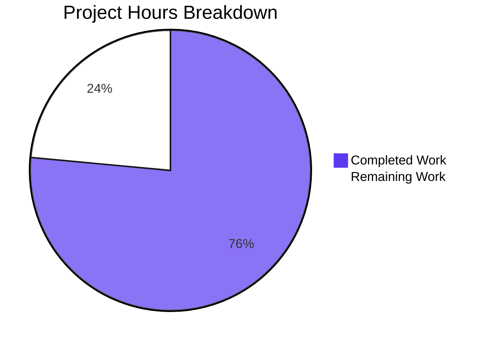
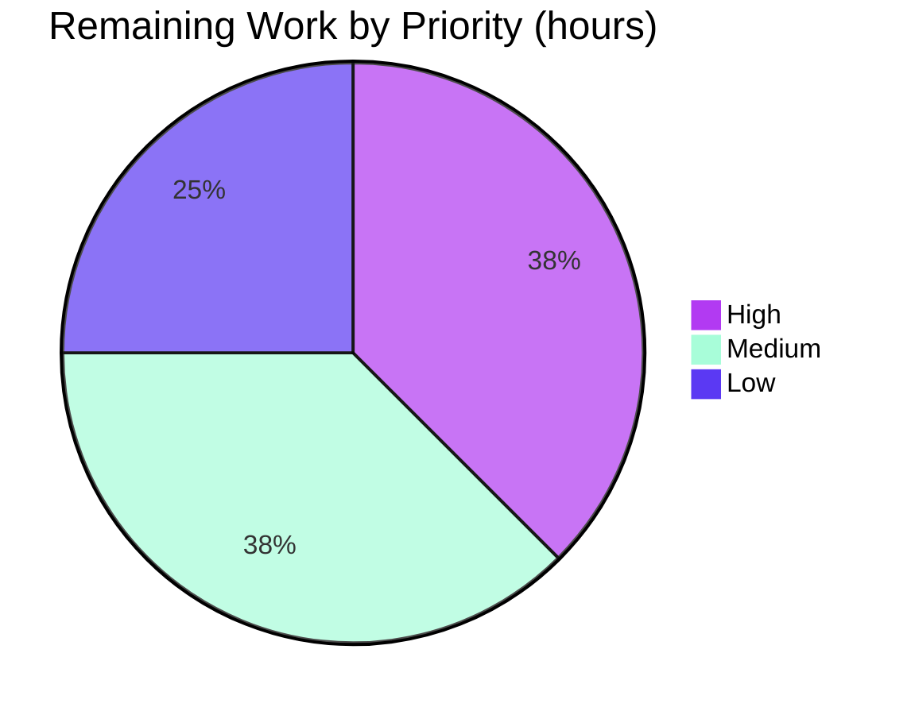

# 1. Executive Summary

## 1.1 Project Overview

This project delivers a two-artefact, dependency-free specification-compliance deliverable: a one-line Python 3 programme that prints `Welcome to Blitzy` unformatted, and a committed text file holding that same line exactly 99,980 times as literal content. The programme runs as `python3 hello_world.py`; the content ships as data, never produced by a script. Its audience is the requester and anyone proving the delivered bytes, and acceptance is evidential: the exact count, byte shape and digest. Technical scope is deliberately minimal.

## 1.2 Completion Status


**76.5% complete** — Completed Work renders in Blitzy Dark Blue (#5B39F3); Remaining Work in White (#FFFFFF).

| Metric | Hours |
|---|---|
| Total Hours | 17 |
| Completed Hours (AI + Manual) | 13 |
| Remaining Hours | 4 |

13 completed hours of 17 total = 76.5% complete, over specification-scoped work and path to production only. Both artefacts are complete and verified byte-for-byte; the 4 remaining hours are in Section 2.2.

## 1.3 Key Accomplishments

- **Unformatted output** — 18 bytes on one line (the string plus one terminator), exit 0, nothing on stderr.
- **Fewest-line implementation** — one line of Python 3: 26 characters, 27 bytes, zero imports.
- **Exact content count** — 99,980 LF-terminated lines of the exact string, by three counters.
- **Byte-exact content shape** — 1,799,640 bytes of ASCII, no byte-order mark, no carriage returns, final newline present.
- **Digest-pinned delivery** — the working file and the committed blob identical under the specified digests.
- **No-generator guarantee and zero surface** — nothing in the tree or delivery path produces those lines; no dependency, input, credential or network path exists.

## 1.4 Critical Unresolved Issues

**6 open items — 2 need a human decision, 4 are accepted caveats needing no change; at the grain of the user's five directives, 5 of 5 are complete.**

| Issue | Impact | Owner | ETA |
|---|---|---|---|
| The repository carries a third committed path — a 41-byte placeholder `README.md` — where the specification describes a two-path checkout | Reviewers may read the extra file as delivered work; it is not | Repository owner | < 1 day |
| The documented runtime figure does not match the interpreter the work was verified on | Documentation only; no acceptance value depends on it | Repository owner | < 1 day |
| Direct execution is unsupported: `./hello_world.py` exits 126 because there is no shebang and no executable bit | Callers must name the interpreter | None — accepted | n/a |
| A hostile stdout (closed read end, full device) ends the run at exit 120 with the interpreter's own flush diagnostic instead of a clean failure | Confined to the consumer's own pipe; a wrapper asserting exit 0 must keep stdout writable | None — accepted | n/a |
| No committed test suite, linter or coverage instrument exists, and none may be added | No coverage figure can be reported; a future change is gated only by the acceptance set | None — accepted | n/a |
| The 99,980-line file cannot be read in a web diff (it exceeds the per-file render limits) | Verification must be by digest or from a local checkout | None — accepted | n/a |

## 1.5 Access Issues

No access issues identified. The deliverable consumes no host resource, reads no credential and calls no external system.

## 1.6 Recommended Next Steps

1. **[High]** Set and document `core.autocrlf=false` for every clone holding this repository. (0.5 h)
2. **[High]** Re-run the acceptance set on the platform that will hold the repository, recording its interpreter. (1 h)
3. **[Medium]** Decide and record the fate of the placeholder `README.md`, reconciling the tree with the two-path specification. (1 h)
4. **[Medium]** Align the project's documentation with the delivered runtime; note that the content file is verified by digest. (0.5 h)
5. **[Low]** Record that the sanctioned absences are deliberate and stand. (1 h)

# 2. Project Hours Breakdown

## 2.1 Completed Work Detail

| Component | Hours | Description |
|---|---|---|
| Printing programme — `hello_world.py` | 2 | The entire implementation: one line, 26 characters, 27 bytes, zero imports, no shebang, comment, error handling or `__main__` guard. Includes the size proof and the byte-exact stdout contract, chosen against the shell `echo` and raw-buffer alternatives, which are longer or shell-dependent. |
| Content artefact — `hello_world.txt` | 4 | Materialising 99,980 LF-terminated occurrences of the exact 17-byte string as the file's own committed body: 1,799,640 bytes, ASCII without a byte-order mark, no blank or trailing-space line, final newline present, digest-pinned. |
| Structural no-generator guarantee and delivery shape | 2 | A flat, two-artefact repository with no producer of the content anywhere in the tree, the index, the commit or the delivery path; nothing beyond the two planned files; both artefacts committed as sources and delivered byte-identical to their blobs. |
| Empty dependency inventory and import-free security posture | 1 | Zero imports, no manifest or lock file, no configuration, no credential, no readable input, no network or dynamic-evaluation path, and therefore no supply-chain surface to audit. |
| Acceptance evidence and verification | 3 | The acceptance command set run against the working file and the committed blob, the single per-change gate, the detectability proof over eleven counterfactual copies of the content file, and the runtime battery across environments, interpreters, locales, invocation modes, output sinks, resource limits, and repeated and concurrent runs. |
| Runtime and delivery integration | 1 | The programme exercised on the delivered platform and on a second interpreter, byte identity proven from a clean export of the committed tree, both artefacts shown untouched by execution, and the one conflict between the user's directives resolved in favour of the prohibition the user stated. |
| **Total** | **13** | |

## 2.2 Remaining Work Detail

| Category | Hours | Priority |
|---|---|---|
| Repository-shape reconciliation — decide and record the fate of the placeholder `README.md` and the empty evidence directories, so the delivered tree is reconciled with the two-path specification | 1 | Medium |
| Runtime documentation alignment — correct the project's stated runtime to the interpreter the deliverable was verified on, and state the supported range (any Python 3) | 0.5 | Medium |
| Clone-level byte contract — document and set `core.autocrlf=false`, and confirm no path attribute or filter applies, so the content file's digest cannot be broken by line-ending translation | 0.5 | Medium |
| Target-platform acceptance re-run — repeat the acceptance set on the image that will hold the repository and record the interpreter it resolves to | 1 | Medium |
| Sanctioned-absence decision record — put on record that the waived practices (no shebang or executable bit, no test scaffold or coverage instrument, no error handling, no logging, no configuration, no pipeline or container files) stand | 1 | Low |
| **Total** | **4** | |

**Hours basis and confidence.** The 13 completed hours are the sum of the six components above, each traced to a specific requirement group and each observable in the delivered artefacts; confidence is High because every value is small, byte-verifiable and independently reproducible. The 4 remaining hours are bounded documentation and confirmation tasks — no artefact is unfinished and no requirement is unbuilt — so confidence there is High as well. Total project hours are 17 = 13 completed + 4 remaining, and the completion percentage is (13 ÷ 17) × 100 = 76.5%. Beyond these five categories the path to production holds no further work: the specification excludes deployment automation, containers, pipelines, environment provisioning and configuration, and the deliverable is two committed files, so there is no build, release, hosting or infrastructure step to schedule.

# 3. Test Results

No test framework is committed and none may be added — a runner or coverage tool would introduce the repository's only dependency and cost lines against the requirement's cap — so the project's verification instrument is its acceptance command set: exact commands with expected output, run against the delivered bytes. The totals below are the command-level assertions executed in this checkout against the working tree and the commit; the same set was exercised repeatedly against the delivered bytes under argument, stdin, locale, encoding, interpreter-mode, working-directory and output-sink variation and in repeated and concurrent runs, with no failing row.

| Area / Category | Framework | Tests | Passed | Failed | Coverage | What This Proves |
|---|---|---|---|---|---|---|
| Content artefact — line count and per-line content | POSIX shell (`wc`, `awk`, `grep`, `sort`) | 6 | 6 | 0 | Not instrumented — the set asserts every line of the file | All 99,980 lines are exactly the required string, with no blank line, no case or whitespace drift and no off-by-one in the count |
| Content artefact — byte shape, encoding and structure | POSIX shell (`tr`, `head`, `tail`, `od`, `awk`) | 7 | 7 | 0 | Not instrumented — the set asserts the whole file | The file is LF-terminated ASCII of 1,799,640 bytes with no byte-order mark, no carriage return and a final newline |
| Content artefact — delivered-byte identity | `git` plumbing, `sha256sum`, `md5sum`, `cmp` | 4 | 4 | 0 | Not instrumented | The working file and the committed blob are the same bytes and both carry the pinned digests |
| Printing programme — declared stdout contract | POSIX shell (`od`, `wc`) | 5 | 5 | 0 | Not instrumented — the set asserts the whole output payload | The documented command prints exactly the 18 required bytes on one line and exits 0 |
| Printing programme — output hygiene and independence | POSIX shell, `cmp` | 4 | 4 | 0 | Not instrumented | Nothing reaches stderr, no escape or carriage-return byte is emitted, and the payload equals an independently built reference |
| Source size proof and import-free property | `wc`, `grep` | 5 | 5 | 0 | n/a — a property of the source text | The programme is one line of 27 bytes with zero imports, no shebang, no comment and no unfinished construct |
| Delivery path, no-producer structure and dependency inventory | `git`, `grep` | 7 | 7 | 0 | Not instrumented — the absence is enumerated | Exactly two files were added, nothing references or produces the content, and no manifest, credential or producer exists |
| Per-change acceptance gate | POSIX shell | 1 | 1 | 0 | Not instrumented | One command asserts the line count, the digest and the output bytes together |
| **Total** | | **39** | **39** | **0** | | |

**Not covered.** Every capability the project delivers is exercised by the set above; no delivered behaviour lies outside it. What no test can reach is what the project contains nothing of: a graphical or browser interface, an HTTP endpoint, service or port, a database, queue or cache, a scheduled job or long-running process, a container image, and a pipeline. Those absences are the specified shape of the deliverable, not untested surface — the repository holds no route, template, UI asset, connection string, job definition or deployment file. No coverage percentage is reported because no coverage instrument exists and none may be added; the verification is exact-value assertions over the entirety of both artefacts instead. Nothing in the repository is stubbed, placeholder-marked or unfinished: a scan for `TODO`, `FIXME`, `XXX`, `HACK`, `placeholder`, `stub` and `NotImplemented` matches nothing in either artefact.

# 4. Runtime Validation & UI Verification

- ✅ **Printing programme executed** — driven from the repository root: stdout is exactly 18 bytes (hex `57656c636f6d6520746f20426c69747a790a`), one line, exit status 0.
- ✅ **Output hygiene** — 0 bytes on stderr, 0 escape bytes, and the payload is identical to an independently built reference (`cmp` exit 0).
- ✅ **Content artefact** — 99,980 lines, every line exactly the required string; 1,799,640 bytes; sha256 and md5 match on the working file and on the committed blob.
- ✅ **Execution leaves the tree untouched** — no `__pycache__` or `.pyc` artefact, no new path, `git status` clean after every run, both artefacts unchanged.
- ✅ **Environment independence** — identical bytes with an empty environment (`env -i`) and with site-packages disabled (`-I -S`), so nothing needs installing or configuring.
- ✅ **Delivery path** — a clean export of the commit reproduces both artefacts byte-identically, and the programme runs from that export with the same output.
- ✅ **Count arithmetic** — both counters report 99980, and the file's final byte is the line terminator the count depends on.
- ⚠ **Invocation** — direct execution `./hello_world.py` exits 126 (no shebang, no executable bit by design); the interpreter must be named: `python3 hello_world.py`.
- ⚠ **Hostile stdout** — against a closed read end or a full device the run ends at exit 120 with the interpreter's own flush diagnostic, and with fd 1 closed before start the single write is a silent no-op.
- ❌ **No UI, service or store to drive** — the deliverable exposes no page, screen, form, endpoint, port, queue or database, so no browser, API, queue or scheduled-job validation applies.

**Never exercised at runtime:** nothing delivered was left unexercised — the programme was run hundreds of times under deliberately varied conditions, and every count, byte-shape, digest and identity property of the content file was measured against both the working file and the committed blob. What has no runtime surface at all, by design rather than by omission, is a graphical interface, an HTTP endpoint or port, a database round trip, a message queue, a scheduled job, a container image and a pipeline: the project delivers none of these and specifies none of them. No browser automation was appropriate or performed.

# 5. Compliance & Quality Review

## 5.1 Compliance Matrix

| Deliverable / Requirement | Benchmark | Status | Verified Standing |
|---|---|---|---|
| Unformatted stdout — print `Welcome to Blitzy` with no format | Output contract honoured to the byte, with no decoration | ✅ Pass | `hello_world.py:1`; 18 bytes, one line, exit 0, 0 stderr bytes, 0 escape bytes |
| Fewest-line implementation, token-optimised | Implementation proportional to the requirement; no scaffolding | ✅ Pass | 1 line, 26 characters, 27 bytes, 0 imports, no shebang, comment or guard |
| Exact content count — 99,980 occurrences | Specification compliance measured on the artefact itself | ✅ Pass | 99,980 by `wc -l`, by `awk 'END{print NR}'` and by whole-line matching |
| No artefact generates the lines | Structural guarantee rather than a promise | ✅ Pass | Nothing in the tree, index, commit or delivery path references or produces the content |
| Count verified against the committed bytes | Verification of the delivered artefact, not a regenerated copy | ✅ Pass | Working file and committed blob share sha256 `101e8751…6ed6` and md5 `75af993e…c1aa`; `cmp` exit 0 |
| Content byte shape and portability | Deterministic, portable delivered data | ✅ Pass | ASCII, no byte-order mark, LF only, final newline present, 1,799,640 bytes |
| Delivery shape — no unrequested scaffolding | Repository contains only what the requirement needs | ✅ Pass | Two files added; no tests, docs, scripts, configuration, pipeline or container file |
| Dependency and supply-chain hygiene | No third-party code; nothing to pin or audit | ✅ Pass | Empty inventory, zero imports, runs with site-packages disabled and an empty environment |
| Security posture | No input, credential, network or dynamic-evaluation surface | ✅ Pass | Zero inputs, sockets, dynamic evaluation and file writes; tree-wide secret scan negative |
| Verification adequacy | Acceptance evidence proves the delivered behaviour | ✅ Pass with caveat | The command set is exhaustive over both artefacts; no suite or coverage figure exists, by design |
| Consumer documentation | A reader can run and verify from the artefact alone | ✅ Pass with caveat | Run and verification are one command each; the recorded runtime figure needs updating (Section 5.2) |
| Determinism and portability of output | The same bytes on any POSIX host with any Python 3 | ✅ Pass | Identical output on two interpreters, five locales, nine interpreter modes, repeated and concurrent runs |

## 5.2 AAP & Rule Divergences and Gaps

| What the AAP/Rule Required | What Was Delivered Instead | Why It Diverged | Impact | Remediation |
|---|---|---|---|---|
| The checkout holds no file or directory beforehand, and its two-row tree block is the whole repository (§0.7.1) | The repository carries a third committed path — a 41-byte placeholder `README.md` — plus two empty evidence directories | The repository was already seeded with an initial commit (`8144a2e`) before either artefact was added; the specification's own scope excludes changing an existing file, so the only settlement available was one it forbids | The delivered tree differs from the shape its specification describes, and the extra file carries prose naming the workspace; the deliverable inventory itself is 2 required / 2 present / 0 missing | Decide and record whether the placeholder and the empty directories stay, are removed or are rewritten (1 h, Section 2.2) |
| The image's runtime is CPython 3.12.3 (§0.2.3, §0.5.6 A1) | The deliverable was built and verified on CPython 3.13.18 as `python3`, with CPython 3.14.4 also present at `/usr/bin/python3` | The figure records a measurement of a different image; the delivered artefact uses no version-specific behaviour and pins no release, and the operative requirement (any Python 3, invoked as `python3`) holds | Documentation only — no acceptance value depends on it, and both interpreters emit the identical 18 bytes | Correct the documented figure and state the supported range (0.5 h, Section 2.2) |
| Standard practice expects a directly executable entry point (§0.5.5, §0.8.2) | No shebang and no executable bit: `./hello_world.py` exits 126 and the documented invocation names the interpreter | A shebang would add a second line and 22 bytes against the request's cap on lines and tokens, which the specification lets outrank default practice | Callers must invoke `python3 hello_world.py`; scripting the bare path fails | None required — closing it would break the line cap. The invocation is documented in Section 9 |
| The specification's acceptance design replaces a test scaffold (§0.5.5, §0.8.2) | No committed test file, test framework, linter, type checker or coverage instrument; verification is the acceptance command set | A scaffold and its assertions would cost lines against the cap, and `pytest` — like any coverage tool — would introduce the repository's only dependency | No pass rate and no coverage percentage can be reported, and a future change is gated only by the acceptance set | None required; record the decision (1 h, Section 2.2, low priority) |
| Byte identity of the delivered content is assured on the delivery path (§0.3.2) | No `.gitattributes`, no Git LFS and no line-ending normalisation configuration; byte identity is asserted by the digest rather than configured | A repository initialised for this delivery leaves `core.autocrlf` unset and the content is LF-only, so a third artefact would claim a risk the checkout does not carry | A clone with line-ending translation enabled would alter the 1.8 MB file and break its digest; the gate reads the committed blob as well as the working file, so it fails loudly instead of silently | Document and set `core.autocrlf=false` per clone (0.5 h, Section 2.2) |
| Default practice expects error handling, logging, comments, package metadata, configuration and release scaffolding (§0.5.5, §0.8.2) | All are absent by design: no error handling, no logging or metrics, no comments or docstrings, no manifest, no configuration, no CI or container files | Each is a named, reasoned waiver in favour of the request's cap on lines and tokens | A consumer that closes stdout early or points it at a full device sees the interpreter's flush diagnostic and exit 120 rather than a clean failure; runs are observable only through stdout and exit status | None required; record the decision (1 h, Section 2.2, low priority) |

**Divergence detail.** The tree-shape divergence is the item to act on first. The placeholder `README.md` arrived with the repository's initial commit `8144a2e`, before either artefact existed, and it is byte-identical now to what it was then: this work neither introduced nor changed it. Its two lines name the workspace and state who created it, which is prose in a repository the specification limits to two artefacts. Because the specification excludes changing an existing file, no fix lay inside its scope, so the decision is a human one — and it changes nothing about the delivered bytes either way. The two empty `blitzy/` directories, which hold no file, are the same case.

The runtime-figure divergence is documentation only and should not be read as instability. The figure `3.12.3` states a measurement of a different image; the interpreter present where the work ran is CPython 3.13.18 as `python3`, with CPython 3.14.4 at `/usr/bin/python3`. The delivered programme is a single call to a builtin whose default line terminator has not changed since it replaced the statement, it pins no release, it references no version, and it produced the identical 18 bytes on both interpreters present. Only the stated number needs correcting; no code, artefact or acceptance value is affected.

The executable-bit divergence is the one most likely to surprise a caller, and it is deliberate rather than overlooked. A shebang would add a second line and 22 bytes to a file whose entire requirement is to be as short as possible, so the specification waives the shebang, the executable bit and any direct-execution contract, and the documented runbook names the interpreter instead. The practical consequence is small but real: `./hello_world.py` exits 126 with `Permission denied`, and anyone wiring the programme into a wrapper, job or test must call `python3 hello_world.py`. Section 9 records this, and no change is warranted.

The verification-instrument divergence changes how this project's quality should be judged rather than what it delivers. A committed suite would cost lines against the cap and a third-party runner — or a coverage tool — would introduce the repository's only dependency, so verification is expressed as exact commands with expected values. The compensating strength is that the set is exhaustive over the whole deliverable: it asserts the complete stdout payload and each of the 99,980 content lines. The cost is equally clear: there is no pass rate and no coverage percentage to quote, and a future edit has no automated gate beyond those commands.

The line-ending divergence is a real, if narrow, exposure, and the project detects rather than prevents it. With no `.gitattributes`, no Git LFS and no normalisation configuration, the delivered bytes are whatever the checkout preserves; the digest is what proves it. A clone created with line-ending translation enabled would add a carriage return to every one of the 99,980 lines — the file would still look correct in a viewer and its line count would still read 99980, but the whole-line match and both digests would fail. Because the gate reads the committed blob as well as the working file, such a clone reports the problem immediately. Setting `core.autocrlf=false` removes the exposure entirely.

The final divergence is the broadest and the least controversial: a dozen ordinary engineering practices are deliberately absent. There is no error handling, so a consumer that closes stdout early gets the interpreter's own flush diagnostic and exit 120; there is no logging, metrics or tracing, so a run is observable only through its stdout and exit status; there are no comments or docstrings, no package metadata, no configuration, no `.gitignore`, no pipeline and no container files. Each was waived with a reason in favour of the request's cap on lines and tokens, none has been reintroduced, and closing any of them would break that cap rather than improve the deliverable.

**No divergence from a user rule was identified, and none is possible: the user supplied no rules for this work.** The one point where the user's own instructions pulled against each other — "create duplicate lines ... in the file" against "I don't want any script which generates these lines" — was resolved in favour of the prohibition, which is the more specific instruction and the higher authority; the 99,980 lines therefore ship as the file's literal body, and the programme writes no file. Reading it the other way would have produced the very artefact the user forbade.

# 6. Risk Assessment

| Risk | Category | Severity | Probability | Mitigation | Status |
|---|---|---|---|---|---|
| A clone created with line-ending translation enabled alters the 1.8 MB content file — the line count still reads 99980, but the whole-line match and both digests break | Technical | Medium | Low | The acceptance gate reads the committed blob as well as the working file, so a translated checkout fails loudly; set and document `core.autocrlf=false` and confirm no path attribute or filter applies | Open — guarded |
| A hostile stdout degrades the run: a closed read end or a full device ends it at exit 120 with the interpreter's own flush diagnostic, and a stdout closed before start makes the single write a silent no-op with exit 0 | Technical | Low | Low | Keep stdout writable and consume or discard the output; a wrapper asserting exit 0 must not close fd 1 | Accepted — direct consequence of the mandated no-error-handling shape |
| No automated gate exists for a future change: there is no committed suite, linter, type checker or coverage instrument to catch an edit to either artefact | Technical | Low | Medium | The acceptance set asserts the complete stdout payload and every one of the 99,980 content lines; run it after any change to either artefact | Open — accepted |
| The change cannot be reviewed in a web diff: 99,980 insertions exceed the per-file diff and preview limits, so the pull request shows a truncated view | Operational | Low | High | Verify by digest and by the count commands from a local checkout; treat the digest as the review artefact | Open — accepted |
| Runs are observable only through stdout and exit status: no logging, metrics or tracing exists, and no health or status surface suits a one-shot process | Operational | Low | Medium | Treat stdout and the exit status as the whole contract; a caller needing more must wrap the process | Open — accepted |
| The version-control layer is the only machinery between the commit and the delivered bytes: four git-lfs dispatcher hooks are active in the checkout and the LFS filter is configured as required | Operational | Low | Low | They are inert for this tree — no path is LFS-tracked, no attribute is set and both blobs are real objects byte-identical to the working files; the blob-versus-working digest comparison is the detector | Open — monitored |
| Interpreter-startup effects outside the artefact can alter what a caller observes: a `sitecustomize` reachable through `PYTHONPATH` can prepend bytes to stdout, and an interpreter installation with a broken path-configuration file writes its own noise to stderr before any code runs | Integration | Low | Low | Invoke with `-I` (or `-S`) in constrained environments, and resolve `python3` to a clean installation; on the documented interpreter stderr is 0 bytes and stdout is exactly 18 bytes | Open — environmental |

**Security.** No security risk is carried. The enumeration behind that verdict is negative rather than assumed: the programme takes no input at all — no argument, environment variable, stdin, socket or file read — it imports nothing, opens no socket, evaluates no dynamic code, writes no file and stores no credential, and its only sink is one write of a compile-time constant literal to standard output. A case-insensitive secret and credential scan over the whole tree matches nothing, and the dependency inventory is empty, so there is no third-party component to audit and no supply-chain surface. The content file is a fixed public string with no personal, credential or regulated data, and no code path in the repository reads or writes it.

**Integration.** No external integration exists to fail. The deliverable calls no service, honours no API contract, exchanges no data format, crosses no authentication boundary and reads no configuration key or secret. Its only two interfaces — the process's standard output and the version-control delivery path — were both exercised end to end, the second from a clean export of the committed tree: the export reproduced both artefacts byte-identically, and the programme produced its exact 18 bytes from it. Residual integration risk is therefore none, not merely unmeasured.

# 7. Visual Project Status

**Hours: completed versus remaining.** Completed Work renders in Blitzy Dark Blue (#5B39F3) and Remaining Work in White (#FFFFFF); the project is **76.5% complete** — 13 hours of 17.



**Priority distribution of the remaining work.** 1.5 hours are High priority, 1.5 hours Medium and 1 hour Low; the slices use the Blitzy accent palette — Violet-Black (#B23AF2) for High, Mint (#A8FDD9) for Medium, Dark Blue (#5B39F3) for Low.



**Remaining hours by category** (the five categories of Section 2.2; the sum equals the Remaining Work value above and the Remaining Hours in Section 1.2).

| Category | Hours | Priority |
|---|---|---|
| Repository-shape reconciliation | 1 | Medium |
| Target-platform acceptance re-run | 1 | Medium |
| Sanctioned-absence decision record | 1 | Low |
| Runtime documentation alignment | 0.5 | Medium |
| Clone-level byte contract | 0.5 | Medium |
| **Total** | **4** | |

# 8. Summary & Recommendations

The project is **76.5% complete** — 13 of 17 specification-scoped hours — and what it delivers is finished rather than nearly finished: both artefacts exist at the repository root, are byte-exact against the commit that carries them, and pass every acceptance row that can be applied to them. The programme writes exactly the 18 bytes it must, on one line, with a clean exit status and nothing on stderr, from a single line of Python 3 with no imports, no configuration and no input of any kind. The content file holds 99,980 LF-terminated occurrences of the exact string in 1,799,640 bytes of ASCII with no byte-order mark and a final newline, and the working file, the committed blob and a clean export of the commit are the same bytes under the same pinned sha256 and md5. At the grain of the user's own instructions — the printed line, the fewest lines, the file with exactly 99,980 occurrences, no generating script, and no deviation from the count — all five are met in full.

What was exercised to prove it is the project's whole verification instrument, because the specification replaces a test suite with exact commands and expected values: the acceptance set asserts the complete standard-output payload and every one of the 99,980 content lines, and it was run against the working file, against the committed blob and against a clean export of the tree. Alongside it, the programme was driven under an empty environment, a site-packages-disabled interpreter, five locales and encoding settings, nine interpreter modes, four working directories, repeated and concurrent runs, and adversarial arguments and stdin payloads; every row produced the same 18 bytes and exit 0. The gaps are equally clear and are recorded above: no coverage instrument exists and none may be added, there is no committed suite or linter, and the surfaces the project does not contain — a UI, an endpoint, a store, a job, a container and a pipeline — have nothing to exercise.

The 4 remaining hours are reconciliation and confirmation, not unfinished work. The delivered tree carries a third committed path, a 41-byte placeholder `README.md` that predates both artefacts, in a repository the specification describes as holding exactly two — a decision for the owner rather than a defect, and the only item needing real judgement. Two items are mechanical: align the project's documented runtime with the interpreter the work was verified on, and set `core.autocrlf=false` at clone time so the content file's digest cannot be broken by line-ending translation. One is confirmatory: re-run the acceptance set on the platform that will hold the repository and record the interpreter it resolves to. The last puts the deliberate absences on record, so a future reader does not mistake a designed waiver for an unfinished task.

The critical path to production is short and carries no engineering risk: fix the clone-level byte contract, re-run acceptance on the target platform, reconcile the tree description, and record the remaining decisions. Nothing on it depends on the other items and none of it touches the delivered bytes. Success is measurable without ambiguity: `python3 hello_world.py` prints exactly `Welcome to Blitzy` on one line with exit status 0; `wc -l` reports 99980; `grep -c -x` reports 99980 matches and 0 non-matching lines; and both the working file and the committed blob hash to `101e8751950d70764669addaa5000df3a05d1bfab4c33139e691b9525f4a6ed6`.

**Production readiness: ready for delivery as specified.** This is a deliberately minimal specification-compliance deliverable — 27 bytes of code plus one data file — not a service, and it asks for no runtime beyond an interpreter and no interface beyond standard output. Both artefacts are deterministic, portable, digest-pinned and reproducible from a clean checkout, and the repository contains no generator, dependency, configuration, secret, build step or delivery-path artefact that could alter them. The residual items are documentation and environment reconciliation plus one tree decision; none of them is a defect in the delivered artefacts, and none blocks handing this repository to its owner.

| Metric | Value |
|---|---|
| Completion | 76.5% (13 of 17 hours) |
| Artefacts delivered | 2 of 2, byte-exact and committed |
| Acceptance rows executed and passed in this checkout | 39 of 39 |
| Failing acceptance rows | 0 |
| Third-party dependencies | 0 |
| Open items requiring a human decision | 2 |
| Accepted caveats requiring no change | 4 |

# 9. Development Guide

## System Prerequisites

- **Operating system:** any Linux or POSIX host. The delivered bytes were produced and verified on Linux; the only platform assumption in the design is a text stream that does not translate newlines.
- **Runtime:** any Python 3 on `PATH`. The work was verified on CPython 3.13.18 and also on CPython 3.14.4, and the programme uses no version-specific behaviour:

```bash
python3 --version
```

- **Verification tools:** the POSIX base utilities `wc`, `grep`, `sort`, `awk`, `tr`, `head`, `tail`, `od`, `sha256sum`, `md5sum` and `cmp`. All are present on a standard Linux image and none is a project dependency.
- **Hardware:** none beyond a filesystem able to hold a 1.8 MB file. There is no compiler, container runtime, database or network requirement, and nothing has to be installed.

## Environment Setup

There is no environment to configure: no virtual environment to create, no variable to export, no secret to set and no service to start. The repository has no manifest and no dependency, and the programme reads no configuration. Run with bytecode writing suppressed (or delete any `__pycache__` afterwards) so no compiled artefact enters the checkout:

```bash
export PYTHONDONTWRITEBYTECODE=1
```

## Dependency Installation

Nothing to install. The third-party dependency inventory is empty — no `requirements.txt`, `pyproject.toml`, `setup.py`, `package.json` or lock file exists — and the programme imports nothing, so it behaves identically with site-packages and user-site disabled and with an empty environment:

```bash
python3 -I -S hello_world.py
env -i PATH=/usr/local/bin:/usr/bin:/bin python3 hello_world.py
```

Each prints `Welcome to Blitzy` and exits 0.

## Application Startup

There is no build step, no server, no port and no background process. From the repository root, run the programme:

```bash
python3 hello_world.py
```

Expected result — exactly one line on standard output, nothing on standard error, exit status 0:

```text
Welcome to Blitzy
```

Confirm the exit status explicitly:

```bash
python3 hello_world.py > /dev/null; echo "exit=$?"
```

## Verification Steps

**1. The single per-change gate.** Run from the repository root; it asserts the line count, the content digest and the standard-output bytes together, and prints `PASS`:

```bash
[ "$(wc -l < hello_world.txt)" = 99980 ] \
  && [ "$(sha256sum < hello_world.txt | cut -d' ' -f1)" = 101e8751950d70764669addaa5000df3a05d1bfab4c33139e691b9525f4a6ed6 ] \
  && [ "$(python3 hello_world.py | od -An -t x1 | tr -d ' \n')" = 57656c636f6d6520746f20426c69747a790a ] \
  && echo PASS
```

**2. The full acceptance set.** Run each line and compare with the expected value in the comment. Do **not** run this under `set -e` — the two `grep` rows expect `0` and exit 1, which is their passing outcome.

```bash
printf 'lines: ';        wc -l < hello_world.txt                      # 99980
printf 'awk lines: ';    awk 'END{print NR}' hello_world.txt          # 99980
printf 'matching: ';     grep -c -x 'Welcome to Blitzy' hello_world.txt   # 99980
printf 'non-matching: '; grep -c -x -v 'Welcome to Blitzy' hello_world.txt # 0  (exit 1)
printf 'distinct: ';     sort -u hello_world.txt | wc -l              # 1
printf 'blank: ';        grep -c '^$' hello_world.txt                 # 0  (exit 1)
printf 'CR bytes: ';     tr -dc '\r' < hello_world.txt | wc -c        # 0  (exit 0)
printf 'first 3: ';      head -c 3 hello_world.txt | od -An -t x1     #  57 65 6c
printf 'bytes: ';        wc -c < hello_world.txt                      # 1799640

sha256sum hello_world.txt                                            # 101e8751…6ed6
git show HEAD:hello_world.txt | sha256sum                            # 101e8751…6ed6

python3 hello_world.py | od -An -t x1 | tr -d ' \n'; echo            # 57656c636f6d6520746f20426c69747a790a
python3 hello_world.py | wc -c                                       # 18
python3 hello_world.py | wc -l                                       # 1
python3 hello_world.py > /dev/null; echo "exit=$?"                   # exit=0
grep -n '^[[:space:]]*\(import\|from\)[[:space:]]' hello_world.py   # no output (exit 1)
```

**3. Confirm the delivered bytes are the committed bytes.** Both comparisons must print nothing and exit 0:

```bash
git show HEAD:hello_world.py  | cmp - hello_world.py
git show HEAD:hello_world.txt | cmp - hello_world.txt
```

**4. Verify from a clean copy of the tree.** Export the commit and repeat the acceptance set there; both artefacts must arrive at their delivered size and digest:

```bash
git archive HEAD | tar -x -C "$(mktemp -d)"
```

## Example Usage

Print the line, and compare it byte-for-byte against an independently built reference (this form needs bash for the process substitution):

```bash
python3 hello_world.py
python3 hello_world.py | cmp - <(printf 'Welcome to Blitzy\n') && echo "identical"
```

Capture the output and confirm its exact size and line count:

```bash
python3 hello_world.py > out.txt
wc -c out.txt    # 18
wc -l out.txt    # 1
rm out.txt
```

Confirm the digest of the content file, and that the file is untouched by execution:

```bash
sha256sum hello_world.txt
python3 hello_world.py > /dev/null
sha256sum hello_world.txt   # unchanged: 101e8751…6ed6
```

## Troubleshooting

| Symptom | Cause | Resolution |
|---|---|---|
| A `grep` row prints `0` and the shell reports a non-zero status | `grep` signals "no lines selected" through exit status 1, and those two rows expect no match | Treat `0` with exit 1 as success; never run the set under `set -e` |
| `./hello_world.py: Permission denied` (exit 126) | There is no shebang and no executable bit, by design | Name the interpreter: `python3 hello_world.py` |
| The digest of `hello_world.txt` does not match after a fresh clone | The clone translated line endings | Set `core.autocrlf=false`, confirm `git check-attr -a` reports no attribute and re-check out; the gate's blob row detects this too |
| The output shows `^M` before the line ending on a terminal | The terminal driver's newline conversion, not the programme's bytes | Measure through a pipe or a file: those carry exactly 18 bytes |
| Unexpected bytes or noise appear around the output | Interpreter startup, not the programme: a `PYTHONPATH`-hosted customisation can prepend bytes, and a broken interpreter installation writes its own noise to stderr | Confirm with `python3 -c pass` under the same conditions, and invoke with `-I` or `-S` to isolate startup |
| The run exits 120 with an "Exception ignored on flushing sys.stdout" note | Standard output was closed early or points at a full device, and error handling is waived by design | Keep standard output writable, or redirect it to a file rather than to a reader that exits immediately |
| The pull request shows the content file truncated | The file exceeds the per-file diff and preview render limits | Verify by digest and by the count commands from a local checkout |
| `__pycache__` or a `.pyc` file appears in the checkout | CPython cached the module | Run with `PYTHONDONTWRITEBYTECODE=1`, or delete the directory; never commit it |

# 10. Appendices

### A. Command Reference

| Purpose | Command (from the repository root) |
|---|---|
| Run the programme | `python3 hello_world.py` |
| Run with bytecode writing suppressed | `PYTHONDONTWRITEBYTECODE=1 python3 hello_world.py` |
| Run with no site-packages or user-site | `python3 -I -S hello_world.py` |
| Per-change acceptance gate | `[ "$(wc -l < hello_world.txt)" = 99980 ] && [ "$(sha256sum < hello_world.txt \| cut -d' ' -f1)" = 101e8751950d70764669addaa5000df3a05d1bfab4c33139e691b9525f4a6ed6 ] && [ "$(python3 hello_world.py \| od -An -t x1 \| tr -d ' \n')" = 57656c636f6d6520746f20426c69747a790a ] && echo PASS` |
| Content line count | `wc -l < hello_world.txt` |
| Newline-independent line count | `awk 'END{print NR}' hello_world.txt` |
| Whole-line matches | `grep -c -x 'Welcome to Blitzy' hello_world.txt` |
| Non-matching lines (expect 0, exit 1) | `grep -c -x -v 'Welcome to Blitzy' hello_world.txt` |
| Distinct line values | `sort -u hello_world.txt \| wc -l` |
| Carriage-return bytes (expect 0) | `tr -dc '\r' < hello_world.txt \| wc -c` |
| First three bytes (no byte-order mark) | `head -c 3 hello_world.txt \| od -An -t x1` |
| Byte size | `wc -c < hello_world.txt` |
| Content digest, working file and committed blob | `sha256sum hello_world.txt` ; `git show HEAD:hello_world.txt \| sha256sum` |
| Content md5 | `md5sum hello_world.txt` |
| Byte-exact comparison, blob versus working file | `git show HEAD:hello_world.txt \| cmp - hello_world.txt` |
| Output bytes | `python3 hello_world.py \| od -An -t x1 \| tr -d ' \n'` |
| Output size and line count | `python3 hello_world.py \| wc -c` ; `python3 hello_world.py \| wc -l` |
| Exit status | `python3 hello_world.py > /dev/null; echo "exit=$?"` |
| Verify from a clean export | `git archive HEAD \| tar -x -C "$(mktemp -d)"` |

### B. Port Reference

No port is used, bound, reserved or contacted. The programme opens no socket, starts no server and makes no outbound call, and the repository contains no service definition, listener or client. There is nothing to allocate, forward or firewall.

### C. Key File Locations

| Path | Role |
|---|---|
| `hello_world.py` | The entire programme: one line, 27 bytes, zero imports. The only runnable path in the repository |
| `hello_world.txt` | The delivered content: 99,980 LF-terminated lines of the required string, 1,799,640 bytes |
| `README.md` | A 41-byte placeholder that predates both artefacts; it is not part of the deliverable and was not modified |
| `.git/hooks/` | Four git-lfs dispatcher hooks installed with the environment. They are not repository content, are not tracked, and no path in this repository is LFS-tracked |
| `blitzy/screenshots`, `blitzy/screen_recordings` | Empty evidence directories present in the working tree; they contain no file |

### D. Technology Versions

| Component | Version |
|---|---|
| Language | Python 3, using only the builtin `print` |
| Runtime verified on | CPython 3.13.18 (the `python3` on `PATH`), and CPython 3.14.4 at `/usr/bin/python3` |
| Pinned interpreter | None — the programme is valid on any Python 3 and references no version |
| Third-party dependencies | None. The inventory is empty and no manifest exists |
| Shell | bash or POSIX `sh` (dash verified); the programme depends on neither |
| Git | Any version able to store a 1.8 MB text blob; the content is an ordinary compressed object, not an LFS pointer |

### E. Environment Variable Reference

None is required and none is read by the deliverable: the programme consults no variable, takes no argument and opens no configuration file, and it produces identical output with an entirely empty environment. Two interpreter-level variables are worth knowing when a caller's output looks unexpected, because they take effect before any delivered code runs: `PYTHONDONTWRITEBYTECODE=1` suppresses `__pycache__` creation and is recommended in this repository, and `PYTHONPATH` can make the interpreter import a startup customisation that writes to standard output — invoke with `-I` or `-S` to isolate that. No secret or credential is referenced anywhere in the project.

### F. Developer Tools Guide

No linter, formatter, type checker, task runner, test runner or coverage tool is configured, recommended or present, and none may be added: a third-party one would introduce the repository's only dependency, and any of them would cost lines against the requirement's cap. Verification is the command set in Section 9 and Appendix A. A syntax check needs nothing extra:

```bash
python3 -m py_compile hello_world.py   # writes a .pyc; run it outside the checkout or with bytecode rewriting redirected
python3 -c "import ast,sys; ast.parse(open('hello_world.py').read())"   # writes nothing
```

The second form is preferable inside the repository because it leaves the checkout clean.

### G. Glossary

| Term | Meaning |
|---|---|
| Acceptance set | The exact commands with their expected output that decide whether the deliverable is correct; this project's replacement for a test suite |
| Blob | The stored content of a file inside Git, as opposed to the file on disk; the delivered artefact is judged on this |
| Completion percentage | Completed specification-scoped hours divided by total specification-scoped hours, expressed as a percentage |
| Content artefact | `hello_world.txt` — the delivered file holding the required string as literal data |
| Digest | The sha256 or md5 hash of a file's bytes, used to prove the delivered bytes exactly |
| Generator | Any artefact that would produce, expand or rewrite the 99,980 lines. The requirement forbids one, and the repository contains none |
| Line terminator | The single `0x0a` byte that ends a line; in the content file its presence on the final line is what makes `wc -l` report 99980 |
| No-generator guarantee | The structural property that no code path links the programme to the content, so no artefact anywhere could produce it |
| Per-change gate | The single command that asserts the line count, the content digest and the output bytes together |
| Specified count | 99,980 — the exact number of occurrences, which the requirement says must not be deviated from |
| Whole-line match | A `grep -x` match requiring the entire line to be the required string, excluding the terminator — the check that proves no line carries a variant or stray whitespace |
